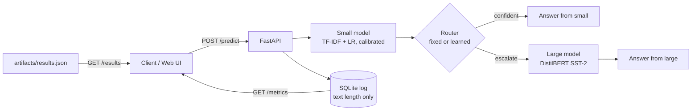
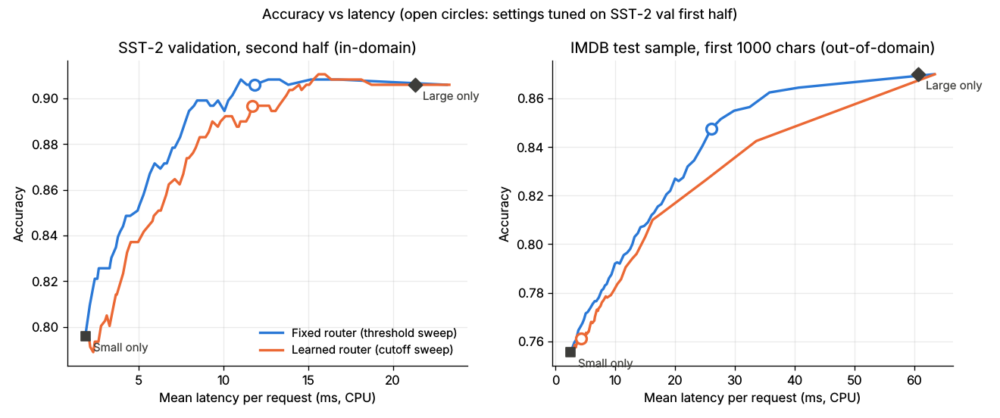
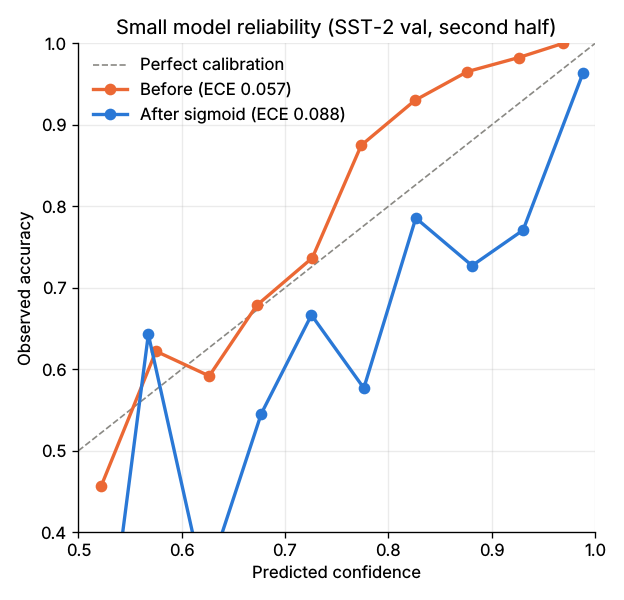

# AdaptiveRoute

**Live demo:** `https://huggingface.co/spaces/<username>/adaptiveroute` (placeholder)

AdaptiveRoute is a confidence-routed sentiment service. Every request is first answered by a cheap model (TF-IDF + logistic regression, sigmoid-calibrated). If a router decides the cheap answer is not trustworthy, the request escalates to a larger model (DistilBERT fine-tuned on SST-2). Two routers are compared: a fixed threshold on the small model's calibrated confidence, and a learned router that predicts "large is right and small is wrong" from small-model-only features. Everything runs on CPU at zero cost: a FastAPI service with a static web UI, offline evaluation, a load test, CI and a free Hugging Face Space (Gradio SDK slot running the FastAPI app via `app.py`; a Dockerfile is also included).

## Architecture



## Data splits

- Small model: 90% of GLUE SST-2 train (60,614 phrases); sigmoid calibration on the held-out 10% (6,735).
- Router training and threshold/cutoff tuning: SST-2 validation, first half (436 sentences).
- Reported in-domain numbers: SST-2 validation, second half (436 sentences).
- Out-of-domain: 2,000 IMDB test reviews sampled with seed 42, truncated to the first 1,000 characters. Nothing is fit on it.
- The large model was fine-tuned on SST-2 train, so in-domain comparisons favour it.

Tuning rule (applied on the tuning half only): pick the setting with the lowest escalation rate whose accuracy is within 1 pp of the best tuning accuracy. A 0.5 pp tolerance was tried first and selected threshold 1.0 (escalate everything), so the tolerance was widened to 1 pp.

## Results

All numbers are measured (CPU, batch size 1, `results/results.csv`). Relative cost counts a small call as 1 and a large call as the measured large/small latency ratio (11.4x on SST-2, 23.4x on IMDB because reviews are longer).

**SST-2 validation, second half (in-domain, n = 436)**

| Setup | Accuracy | Escalated | Mean ms | p95 ms | Rel. cost |
|---|---|---|---|---|---|
| Small only | 79.6% | 0% | 1.87 | 2.42 | 1.00 |
| Large only | 90.6% | 100% | 21.30 | 30.24 | 11.40 |
| Fixed @ 0.85 (default) | 89.7% | 33.5% | 9.24 | 28.85 | 4.82 |
| Fixed @ 0.94 (tuned) | 90.6% | 45.4% | 11.83 | 29.70 | 6.18 |
| Learned @ 0.41 (tuned) | 89.7% | 45.2% | 11.71 | 29.44 | 6.15 |

**IMDB sample (out-of-domain, n = 2,000)**

| Setup | Accuracy | Escalated | Mean ms | p95 ms | Rel. cost |
|---|---|---|---|---|---|
| Small only | 75.6% | 0% | 2.59 | 3.56 | 1.00 |
| Large only | 87.0% | 100% | 60.63 | 88.45 | 23.38 |
| Fixed @ 0.85 (default) | 81.7% | 24.6% | 17.73 | 77.19 | 6.74 |
| Fixed @ 0.94 (tuned) | 84.8% | 38.3% | 26.05 | 82.15 | 9.94 |
| Learned @ 0.41 (tuned) | 76.1% | 3.3% | 4.37 | 4.14 | 1.76 |



### Key findings

- **In-domain, the tuned fixed router matches the large model's accuracy (90.6%) while escalating 45.4% of requests**, cutting mean latency from 21.3 ms to 11.8 ms and relative cost from 11.4 to 6.2. p95 latency barely moves (29.7 vs 30.2 ms) because the slowest requests are the escalated ones.
- **Learned vs fixed:** the learned router (CV AUC 0.774 on the tuning half) did not beat the fixed threshold. In-domain it reached 89.7% at the same 45% escalation where the fixed router reached 90.6%. Its features add little beyond the small model's own confidence, and the tuning set has only 51 positive examples.
- **Out-of-domain:** the fixed router still recovers most of the gap (84.8% vs 87.0% for large only, at 38% escalation and 43% of the large model's mean latency). The learned router collapses to 3.3% escalation and 76.1% accuracy: it learned a negative weight on text length from short SST-2 sentences, and long IMDB reviews push its score below the cutoff. A confidence threshold transfers; the learned router does not.
- Savings are moderate rather than dramatic: matching large-model accuracy in-domain still needs almost half the traffic to escalate.

### Calibration (small model)

| Split | Accuracy | ECE before | ECE after sigmoid |
|---|---|---|---|
| Held-out 10% of SST-2 train (calibration split) | 90.7% | 0.127 | 0.012 |
| SST-2 validation, second half | 79.6% | 0.057 | 0.088 |

Calibration fixes the in-distribution split but makes ECE worse on validation sentences. SST-2 train is mostly short phrases while validation is full sentences, so the calibrator learns to be confident on the wrong distribution. The router still works because ranking by confidence, not its absolute value, is what the threshold uses.



### Error analysis

`results/errors.md` lists the 15 most confident wrong small-model predictions on SST-2 validation second half. 5 contain a negation word and 5 contain but/however/although. The patterns are contrast clauses where the final clause decides the sentiment, negation that flips a polar word ("don't be fooled by the impressive cast"), negative meaning in words that look neutral, and irony ("fancy a real downer?"). The large model gets 9 of the 15 right, but the tuned fixed router escalates only 3 of them: these errors are confident by construction, so no confidence threshold catches them.

### Load test

Locust, 20 users, 60 s, local uvicorn (single worker, CPU), both routers mixed (`results/load.json`): 3,624 requests, 0 failures, 61.3 requests/s, p50 12 ms, p95 100 ms end to end.

## Limitations

- Single task (binary English sentiment) and a single small/large pair.
- Request logs are SQLite in `/tmp`; on the free Spaces tier they are ephemeral and reset on restart.
- Latencies are CPU-only and machine-dependent; the Space hardware will differ.
- The large model was fine-tuned on SST-2 train, overlapping with the small model's training data, which inflates its in-domain advantage.
- The router tuning set is small (436 sentences, 51 positives for the learned router).

## API

```bash
curl -X POST http://localhost:7860/predict \
  -H 'content-type: application/json' \
  -d '{"text": "not bad, but not memorable either", "router": "fixed"}'
```

```json
{"label":"negative","confidence":0.9957,"model":"small","escalated":false,"small_label":"negative",
 "small_confidence":0.9957,"router":"fixed","threshold":0.85,"latency_ms":3.35}
```

Endpoints: `GET /health`, `POST /predict` (`router`: `fixed` | `learned`; `threshold` 0.5 to 1.0; text 1 to 1000 chars), `GET /metrics`, `GET /results`, `GET /` (UI), `GET /docs`.

## Run locally

```bash
python3.11 -m venv .venv && source .venv/bin/activate
pip install --extra-index-url https://download.pytorch.org/whl/cpu -r requirements.txt
uvicorn app.main:app --port 7860           # http://localhost:7860
pytest -q

# Reproduce the offline results (downloads SST-2, IMDB and DistilBERT)
cd scripts
python train_small.py
python build_router.py                     # first run caches both models' predictions
python evaluate.py
python loadtest.py --host http://127.0.0.1:7860   # with the server running

docker build -t adaptiveroute . && docker run -p 7860:7860 adaptiveroute
```
